# campsismisc 

<!-- badges: start -->

[](https://github.com/Calvagone/campsismisc/actions)
[](https://app.codecov.io/gh/Calvagone/campsismisc)
<!-- badges: end -->

## Forest plots

Assume the following estimated 2-compartment model:

``` r
library(campsis)
library(campsisnca)
library(campsismisc)
library(progressr)

model <- read.campsis("tests/testthat/campsis_models/metaboliser_effect_on_cl/")
model
```

    ## [MAIN]
    ## TVMETAB_CL=0
    ## if (METAB == 1) TVMETAB_CL=THETA_METAB_CL
    ## MU_1=THETA_DUR
    ## MU_2=THETA_VC
    ## MU_3=THETA_VP
    ## MU_4=THETA_Q
    ## MU_5=THETA_CL + TVMETAB_CL
    ## TVPROP_RUV=THETA_PROP_RUV
    ## DUR=exp(ETA_DUR + MU_1)
    ## VC=(1.0/70.0)*WT*exp(ETA_VC + MU_2)
    ## VP=(1.0/70.0)*WT*exp(ETA_VP + MU_3)
    ## Q=exp(ETA_Q + MU_4)
    ## CL=exp(ETA_CL + MU_5)
    ## PROP_RUV=exp(TVPROP_RUV)
    ## D1=DUR
    ## S1=VC
    ## 
    ## [ODE]
    ## d/dt(A_1)=-A_1*CL/VC - A_1*Q/VC + A_2*Q/VP
    ## d/dt(A_2)=A_1*Q/VC - A_2*Q/VP
    ## 
    ## [DURATION]
    ## A_1=D1
    ## 
    ## [ERROR]
    ## CONC=A_1/VC
    ## IPRED=-6.9077552789821368
    ## if (CONC > 0) IPRED=log(CONC)
    ## W=PROP_RUV
    ## Y=EPS_RSV_FIX*W + IPRED
    ## 
    ## 
    ## THETA's:
    ##       name index     value   fix                           label unit
    ## 1      DUR     1  0.414183 FALSE                        Duration    h
    ## 2       VC     2  4.432130 FALSE                  Central volume    L
    ## 3       VP     3  5.195360 FALSE               Peripheral volume    L
    ## 4        Q     4  1.404670 FALSE Inter-compartmental\\nclearance  L/h
    ## 5       CL     5  1.659260 FALSE                       Clearance  L/h
    ## 6 PROP_RUV     6 -1.954050 FALSE              Proportional error <NA>
    ## 7 METAB_CL     7  0.243992 FALSE               Metabolism effect <NA>
    ##             se         rse%
    ## 1 3.399015e-02 8.206553e+00
    ## 2 3.975538e-02 8.969813e-01
    ## 3 2.445976e-07 4.708002e-06
    ## 4 4.577521e-06 3.258788e-04
    ## 5 3.756954e-02 2.264234e+00
    ## 6 4.252646e-02 2.176324e+00
    ## 7 7.265659e-02 2.977827e+01
    ## OMEGA's:
    ##   name index index2       value   fix type           se      rse%
    ## 1  DUR     1      1 1.54000e-02 FALSE  var 8.199963e-03  53.24652
    ## 2   VC     2      2 3.64502e-02 FALSE  var 1.031518e-02  28.29939
    ## 3   VP     3      3 3.35092e-15 FALSE  var 2.561220e-14 764.33350
    ## 4    Q     4      4 9.28255e-13 FALSE  var 5.436469e-12 585.66552
    ## 5   CL     5      5 2.97127e-02 FALSE  var 8.809904e-03  29.65030
    ## SIGMA's:
    ##      name index index2 value  fix type
    ## 1 RSV_FIX     1      1     1 TRUE  var
    ## Variance-covariance matrix available (see ?get_var_cov)
    ## 
    ## Compartments:
    ## A_1 (CMT=1)
    ## A_2 (CMT=2)

This model contains:

- a metabolism effect on the clearance: `THETA_METAB_CL`
- allometric scaling on central and peripheral volumes with a fixed
  exponent of 1
- a variance-covariance matrix

### Configure your simulation settings

``` r
# Configure hardware
settings <- Settings(Hardware(cpu=4, replicate_parallel=TRUE))
dest <- "mrgsolve" # Much faster than RxODE
```

### Effect of metabolism effect and weight on model parameters

Let’s show how the metabolism effect and the weight influence the
clearance or the volume. This can be achieved as follows:

``` r
outputs <- c("CL", "VC")

fp <- ForestPlot(model=model, outputs=outputs, replicates=100, dest=dest, settings=settings) %>%
    add(CategoricalLabeledCovariate(name="METAB", default_value=0, label="Metaboliser", categories=c(Slow=0, Fast=1))) %>%
    add(LabeledCovariate(name="WT", default_value=70, label="Weight", unit="kg")) %>%
    add(ForestPlotItem(Covariate("METAB", 0))) %>%
    add(ForestPlotItem(Covariate("METAB", 1))) %>%
    add(ForestPlotItem(Covariate("WT", 60))) %>%
    add(ForestPlotItem(Covariate("WT", 80)))

fp <- with_progress({fp %>% prepare()})
```

The forest plot for clearance can be otained as follows (use `index=1`):

``` r
fp %>% get_forest_plot(index=1) +
  ggplot2::scale_y_continuous(breaks=c(0.7,0.8,1,1.25,1.4), limits=c(0.5, 1.5))
```

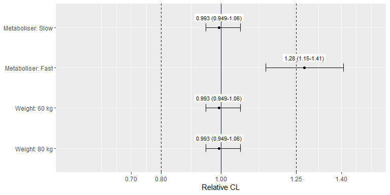

Similarly, the forest plot for volume can be obtained as follows (use
`index=2`):

``` r
fp %>% get_forest_plot(index=2) +
  ggplot2::scale_y_continuous(breaks=c(0.7,0.8,1,1.25,1.4), limits=c(0.5, 1.5))
```

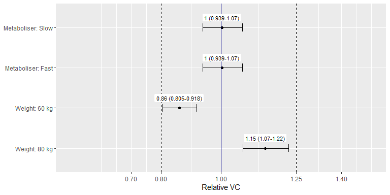

### Effect of metabolism and weight on PK metrics

Let’s show how the metabolism effect and the weight influence PK
metrics. For that, we need to create first a dataset. Assume we are
interested to compute AUC/Cmax on day 1 and day 7. We give the drug
every day and we observe on day 1 and day 7.

``` r
dataset <- Dataset(1) %>%
    add(Infusion(time=0, amount=1000, compartment=1, ii=24, addl=6)) %>%
    add(Observations(times=c(0:24, 144:168)))
```

PK metrics can be added directly using the `campsisnca` API:

``` r
outputs <- NCAAnalysis(variable="CONC") %>%
  add(AUC(window=TimeWindow(0, 24), name="AUC Day 1")) %>%
  add(AUC(window=TimeWindow(144, 168), name="AUC Day 7")) %>%
  add(Cmax(window=TimeWindow(0, 24), name="Cmax Day 1")) %>%
  add(Cmax(window=TimeWindow(144, 168), name="Cmax Day 7"))
```

A forest plot object can be instantiated and run as follows:

``` r
fp <- ForestPlot(model=model, dataset=dataset, outputs=outputs,
                 replicates=100, dest=dest, settings=settings) %>%
    add(CategoricalLabeledCovariate(name="METAB", default_value=0, label="Metaboliser", categories=c(Slow=0, Fast=1))) %>%
    add(LabeledCovariate(name="WT", default_value=70, label="Weight", unit="kg")) %>%
    add(ForestPlotItem(Covariate("METAB", 0))) %>%
    add(ForestPlotItem(Covariate("METAB", 1))) %>%
    add(ForestPlotItem(Covariate("WT", 60))) %>%
    add(ForestPlotItem(Covariate("WT", 80)))

fp <- with_progress({fp %>% prepare()})
```

We can look at AUC day 1 by doing:

``` r
fp %>% get_forest_plot(index=1) +
  ggplot2::scale_y_continuous(breaks=c(0.7,0.8,1,1.25,1.4), limits=c(0.5, 1.5))
```

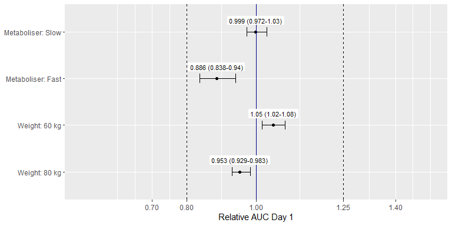

If we are interested to see the absolute change in AUC, argument
relative can be set to FALSE as follows.

``` r
fp %>% get_forest_plot(index=1, relative=FALSE)
```

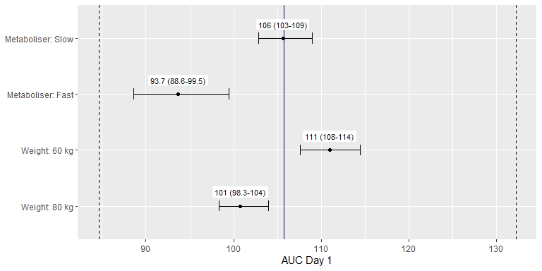

To look at AUC on day 7, we proceed as follows:

``` r
fp %>% get_forest_plot(index=2) +
  ggplot2::scale_y_continuous(breaks=c(0.7,0.8,1,1.25,1.4), limits=c(0.5, 1.5))
```

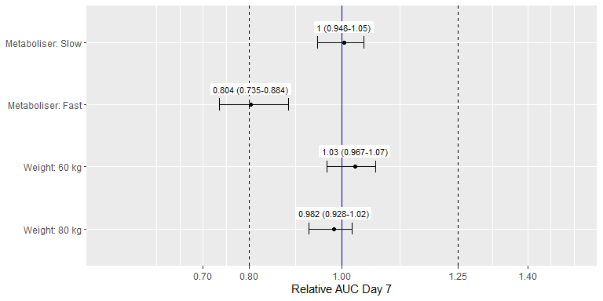

Again, we can look at the absolute values.

``` r
fp %>% get_forest_plot(index=2, relative=FALSE)
```

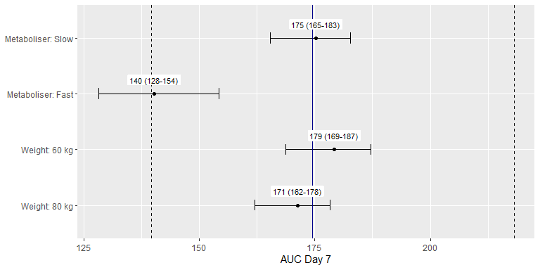

Let’s produce one more plot with Cmax on day 1.

``` r
fp %>% get_forest_plot(index=3) +
  ggplot2::scale_y_continuous(breaks=c(0.7,0.8,1,1.25,1.4), limits=c(0.5, 1.5))
```

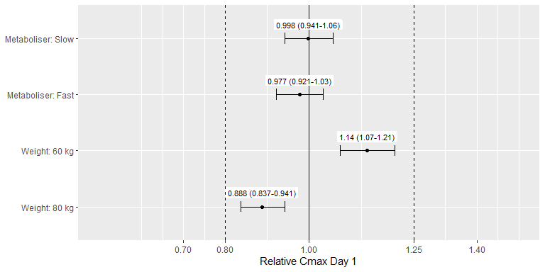

And a final one with Cmax on day 7.

``` r
fp %>% get_forest_plot(index=4) +
  ggplot2::scale_y_continuous(breaks=c(0.7,0.8,1,1.25,1.4), limits=c(0.5, 1.5))
```

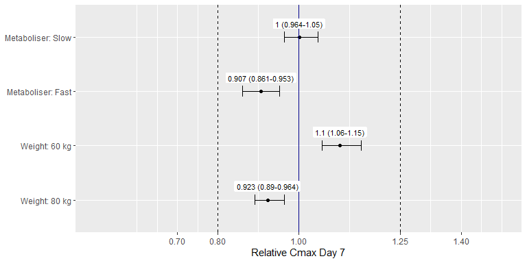

Finally, you need to know that you can combine model parameter ouputs
together with NCA metric outputs, if you want! This will make your
simulations even faster. In that specific case, Campsis will check that
your model parameters do not vary over time (since several observations
are provided in the dataset).

## OAT-method based sensitivity analysis

### Effect of model parameters on PK metrics

Assume the same 2-compartment model. Let’s see how the model parameters
influence AUC or Cmax if they are multiplied by two. This can be
achieved with a one-at-a-time (OAT)-method-based sensitivity analysis.
Most of the time, these analyses are done without parameter uncertainty
(replicates=1, by default) and represented with tornado plots, as shown
below. However if parameter uncertainty is used, you can still call
`get_forest_plot()` on this new type of object.

``` r
outputs <- NCAAnalysis(variable="CONC") %>%
  add(AUC()) %>%
  add(Cmax())

dataset <- Dataset(1) %>%
  add(Infusion(time=0, amount=1000, compartment=1)) %>%
  add(Observations(times=seq(0, 24, by=0.1))) %>%
  add(Covariate("METAB", 0)) %>%
  add(Covariate("WT", 70))

object <- SensitivityAnalysis(model=model, dataset=dataset, outputs=outputs) %>%
  add(SensitivityAnalysisItem(Change("DUR", up=2, down=2, log=TRUE))) %>%
  add(SensitivityAnalysisItem(Change("VC", up=2, down=2, log=TRUE))) %>%
  add(SensitivityAnalysisItem(Change("VP", up=2, down=2, log=TRUE))) %>%
  add(SensitivityAnalysisItem(Change("Q", up=2, down=2, log=TRUE))) %>%
  add(SensitivityAnalysisItem(Change("CL", up=2, down=2, log=TRUE)))

object <- object %>% prepare()
object %>% get_tornado_plot(index=1)
```

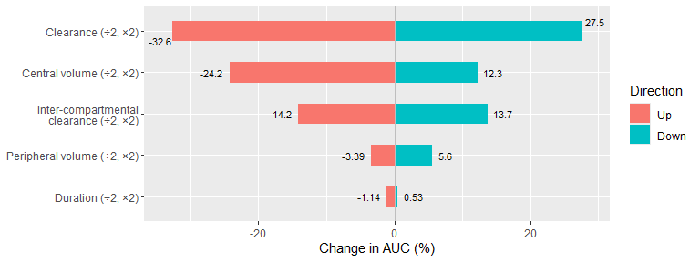

Absolute values may also be shown:

``` r
object %>% get_tornado_plot(index=1, relative=FALSE)
```

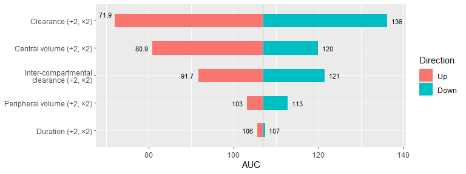

Cmax can also be shown using `index=2`.

``` r
object %>% get_tornado_plot(index=2)
```

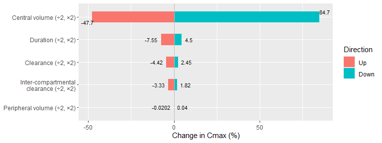
